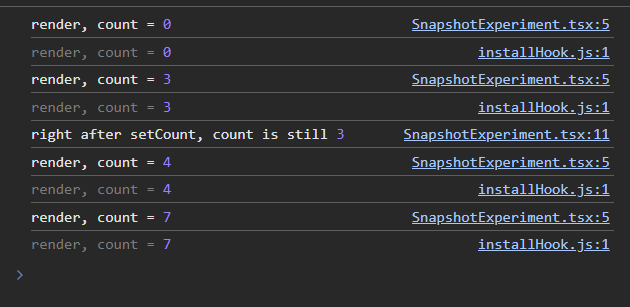
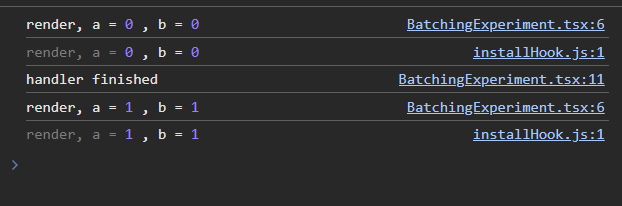
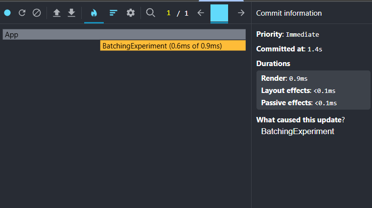
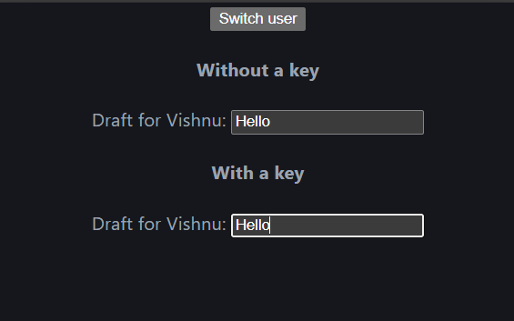
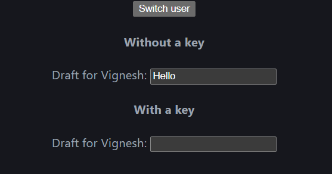
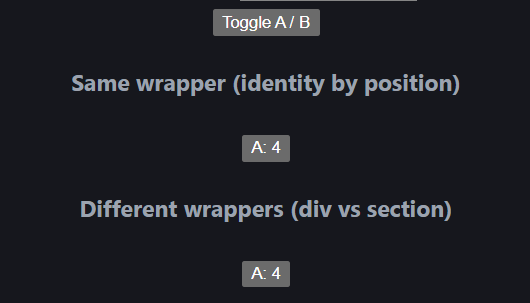
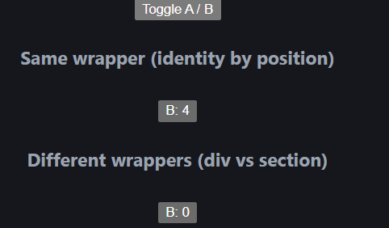
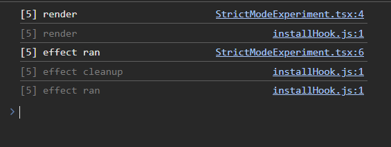

# Rendering experiments

## Experiment 1: State snapshot

**Code:** [SnapshotExperiment.tsx](../src/experiments/SnapshotExperiment.tsx)

**What I did:** Clicked the "updater function" button, then the "count + 1" button, then the "updater function" button again.

**Observation:**

- The updater button added 3 each time (0 -> 3, 4 -> 7).
- The "count + 1" button added only 1 (3 -> 4).
- The log right after setCount printed the old count (3), not the new one (4).

**Evidence:** 

**Why:** 
State in React works like a snapshot. Each time React renders the component, `count` has one fixed value for that whole render. In my test the value was 3, so every `setCount(count + 1)` call inside the handler used 3 and asked for 4. React got three requests for the same value, so the count only went up by 1.

`setCount` does not change the `count` variable in the current render. It only asks React to render again with a new value. That is why the log right after `setCount` still printed the old value (3). The new value (4) only showed up in the next render.

`setCount((c) => c + 1)` is different. I give React an instruction instead of a number, so React applies each one to the latest value (3 -> 4 -> 5 -> 6) and the count goes up by 3.

## Experiment 2: Batching

**Code:** [BatchingExperiment.tsx](../src/experiments/BatchingExperiment.tsx)

**What I did:** Clicked "Update a and b" once. The handler calls `setA(a + 1)` and `setB(b + 1)`, then logs "handler finished".

**Observation:**

- "handler finished" was logged before the new render.
- There was only one render after the click, with a = 1 and b = 1. There was never a render with a = 1 and b = 0.
- The React DevTools Profiler showed a single commit (1 / 1) for the click.

**Evidence:**

**Why:**
React batches state updates. Calling `setA` and `setB` doesn't redraw the screen straight away. React collects both requests while the event handler is still running, and when the handler finishes it re renders once with all the new values. This is faster than rendering after every `setState`, and it means the screen never shows a half updated state (a new `a` with an old `b`).

## Experiment 3: Key reset

**Code:** [KeyResetExperiment.tsx](../src/experiments/KeyResetExperiment.tsx)

**What I did:** Typed "Hello" into two `Draft` inputs: one without a key and one with `key={user}`. Then clicked "Switch user" (Vishnu -> Vignesh).

**Observation:**

- The input without a key still showed "Hello" after the switch. Only the label changed.
- The input with a key was empty after the switch.

**Evidence:**

Before: 

After: 

**Why:** A key tells React which component is which. Without a key, React sees the same `Draft` in the same place on the next render, so it keeps the existing component and its state (the typed text) and only updates the props. With `key={user}`, the key changed from "Vishnu" to "Vignesh", so React treats it as a different component. It throws away the old one along with its state and creates a new one, which starts with empty text.

## Experiment 4: Identity by position

**Code:** [PositionExperiment.tsx](../src/experiments/PositionExperiment.tsx)

**What I did:** I clicked both counters until each showed 4, clicked "Toggle A / B" once. The first counter has the same wrapper in both branches. In the second one, A is wrapped in a `div` and B is wrapped in a `section`.

**Observation:**

- Same wrapper: the number stayed at 4. Only the label changed (A -> B).
- Different wrappers (`div` vs `section`): the number reset to 0, and the label became B.

**Evidence:**

Before toggling (both counters at 4): 

After toggling (same wrapper keeps 4, different wrappers reset to 0): 

**Why:**
React matches children by type and position in the tree, not by the `label` prop. In the first pair both branches render a `Counter` inside the same `div`, in the same place. React keeps that instance and its `n` state, and only updates the prop, so A: 4 becomes B: 4.

In the second pair, React finds a different element type at the same position (`div` → `section`). It throws away the whole old subtree, so the old `Counter` is unmounted and a new one is mounted. A new instance means `useState(0)` runs again, so the count is 0.

## Experiment 5: Strict Mode

**Code:** [StrictModeExperiment.tsx](../src/experiments/StrictModeExperiment.tsx)

**What I did:** Kept `<StrictMode>` in [main.tsx](../src/main.tsx).

**Observation:** On reload the console showed, in this order:

1. `[5] render`
2. `[5] render`
3. `[5] effect ran`
4. `[5] effect cleanup`
5. `[5] effect ran` again

**Evidence:** 

**Why:**
In development, Strict Mode renders each component twice to check that rendering is pure, and runs effects as mount, unmount, mount again to check that cleanup undoes the effect properly. Neither extra pass happens in production.